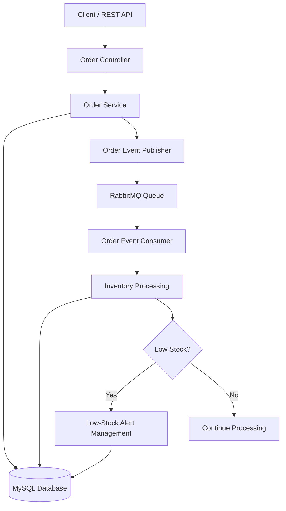

# Event-Driven Inventory & Low-Stock Alert System

A backend-focused inventory management system built with **Java, Spring Boot, MySQL, and RabbitMQ** to process order events asynchronously, maintain product stock, and manage low-stock alerts.

The project demonstrates event-driven architecture, asynchronous message processing, REST API development, database persistence, and alert lifecycle management.

## Overview

Traditional inventory systems often couple order processing with stock updates and alert generation. This project uses RabbitMQ to decouple order creation from inventory processing, allowing events to be handled asynchronously by a dedicated consumer.

When an order is created, an event is published to RabbitMQ. The consumer processes the event, updates the product inventory, and checks whether the remaining stock has reached the configured low-stock threshold.

## Key Features

- **RESTful APIs:** Create and retrieve orders, products, and inventory alerts.
- **Event-driven processing:** Publish order events through RabbitMQ.
- **Asynchronous consumption:** Process order events independently of the order creation request.
- **Inventory tracking:** Update product stock quantities after valid order events.
- **Low-stock detection:** Generate alerts when stock reaches or falls below the configured threshold.
- **Duplicate alert prevention:** Update an existing pending alert for a product instead of creating unnecessary duplicate pending alerts.
- **Alert lifecycle management:** Track alert statuses, including `PENDING` and `RESTOCKED`.
- **Persistent storage:** Store inventory, orders, and alerts in MySQL.
- **Containerized messaging:** Run RabbitMQ using Docker Compose.

## Technology Stack

| Technology | Purpose |
|---|---|
| Java 21 | Backend development |
| Spring Boot | Application framework |
| Spring Web | REST API development |
| Spring Data JPA | Database access and persistence |
| MySQL | Relational database |
| RabbitMQ | Asynchronous message broker |
| Docker Compose | RabbitMQ environment setup |
| Maven | Dependency and build management |
| IntelliJ IDEA | Development environment |

## Architecture



### Event Processing Flow

1. A client submits an order through the REST API.
2. The application saves the order and publishes an order-created event.
3. RabbitMQ places the event in the order queue.
4. The consumer receives and processes the event.
5. The product's available stock is updated.
6. The consumer checks the remaining quantity against the low-stock threshold.
7. An existing pending alert is updated, or a new alert is created when necessary.

## Project Structure

```text
inventory-alert-system/
├── src/
│   ├── main/
│   │   ├── java/
│   │   │   └── com/inventory/alertsystem/
│   │   │       ├── config/
│   │   │       ├── Controller/
│   │   │       ├── Entity/
│   │   │       ├── Repository/
│   │   │       ├── Service/
│   │   │       ├── consumer/
│   │   │       └── event/
│   │   └── resources/
│   │       └── application.properties
│   └── test/
├── compose.yaml
├── pom.xml
└── README.md
```

## Prerequisites

Install the following before running the application:

- Java Development Kit (JDK) 21
- Maven, or use the Maven Wrapper if included
- MySQL Server
- Docker Desktop
- Git

## Getting Started

### 1. Clone the Repository

```bash
git clone https://github.com/venkatesanE/inventory-alert-system.git
cd inventory-alert-system
```

### 2. Configure MySQL

Create a MySQL database named `inventory`.

Configure the database connection in `src/main/resources/application.properties` with your local MySQL connection details.

Keep database credentials outside version control. Do not commit real passwords, access tokens, or other secrets.

### 3. Start RabbitMQ

Run the following command from the project root:

```bash
docker compose up -d
```

This starts RabbitMQ with the management interface enabled.

- AMQP messaging: port `5672`
- Management dashboard: port `15672`

Open `http://localhost:15672` to access the RabbitMQ dashboard. Use the credentials configured for your RabbitMQ instance.

### 4. Run the Application

Start the Spring Boot application from IntelliJ IDEA by running the main application class, or use Maven:

```bash
mvn spring-boot:run
```

Ensure MySQL and RabbitMQ are running before starting the application.

## API Overview

The following endpoints are available in the current application.

| Method | Endpoint | Purpose |
|---|---|---|
| `POST` | `/api/orders` | Create an order |
| `GET` | `/api/products` | Retrieve products |
| `GET` | `/api/alerts` | Retrieve inventory alerts |
| `GET` | `/api/alerts/status/{status}` | Filter alerts by status |
| `PATCH` | `/api/alerts/{id}/status?status=RESTOCKED` | Update an alert status |

### Create an Order

**Request**

`POST /api/orders`

```json
{
  "productId": 1,
  "quantity": 2
}
```

The request uses an existing product ID and a positive order quantity. The resulting order event is published to RabbitMQ for asynchronous processing.

### Retrieve Low-Stock Alerts

**Request**

`GET /api/alerts`

This endpoint returns the stored inventory alerts, including their product information, stock level, threshold, and status.

### Update an Alert Status

**Request**

`PATCH /api/alerts/4/status?status=RESTOCKED`

This marks the specified alert as restocked, provided the alert exists and the status is accepted by the application.

## Low-Stock Alert Logic

Each product has a configurable low-stock threshold.

For example:

| Property | Example |
|---|---:|
| Product | Dell Laptop |
| Initial stock | 10 |
| Order quantity | 6 |
| Remaining stock | 4 |
| Low-stock threshold | 5 |
| Alert status | `PENDING` |

Since the remaining stock is less than or equal to the threshold, the system creates a low-stock alert.

When another order causes the same product to remain below the threshold, the system updates the existing pending alert rather than creating another pending alert for that product.

## Reliability Considerations

Event-driven systems require careful handling of invalid orders, message retries, duplicate deliveries, and failures between database updates and message publishing.

The current implementation includes basic insufficient-stock handling in the consumer. Production deployment should also incorporate robust order validation before accepting orders, explicit rejection statuses, controlled retry policies, dead-letter queues, and transaction-safe event publishing.

These improvements help prevent invalid orders, repeated failed-message processing, and inconsistent inventory state.

## Future Enhancements

- Validate stock availability before accepting an order.
- Add explicit order statuses for accepted and rejected orders.
- Configure retry policies and dead-letter queues.
- Implement transaction-safe event publishing with the transactional outbox pattern.
- Add idempotent event processing.
- Add automated unit and integration tests.
- Introduce structured logging and monitoring.
- Add authentication and role-based access control.
- Containerize the Spring Boot application alongside MySQL and RabbitMQ.

## Learning Outcomes

This project provides practical experience with:

- Building REST APIs using Spring Boot.
- Designing entity and repository layers with Spring Data JPA.
- Integrating MySQL with a Java backend.
- Implementing asynchronous communication using RabbitMQ.
- Managing inventory state through event consumers.
- Designing low-stock alert workflows.
- Running infrastructure services using Docker Compose.

---

**Project:** Event-Driven Inventory & Low-Stock Alert System

**Status:** Under active development
